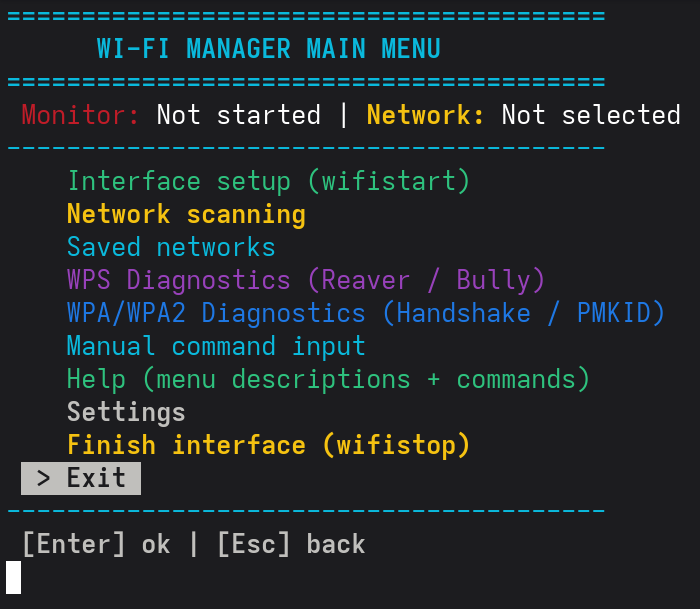

# Wi-Fi Manager

<p align="center">
  
</p>

> ### 🟢 Not updated often — but that doesn't mean it doesn't work.
> It's finished, it's tested, and it does its job. A calm, self-contained tool that just runs when you need it.

A menu-driven terminal tool for **testing and auditing the security of your own Wi-Fi networks**. Wi-Fi Manager wraps well-known utilities (aircrack-ng, hcxdumptool, reaver, bully, hcxtools) into one friendly interface — approachable for cybersecurity students, still useful for professionals.

**🌍 Fully bilingual — English and Russian.** The whole interface, every menu, the built-in Help, and all prompts are available in both languages. You pick your language at install time and can switch it anytime in **Settings**.

---

## ⚠️ Legal notice

This is a **network testing bench**. Use it **only** on networks you own or have explicit permission to test. Unauthorized access to other people's networks is illegal in most countries — the responsibility is entirely yours.

---

## ✨ Features

- **Fully bilingual (EN / RU)** — language choice at install, switchable anytime in Settings.
- **Menu-driven interface** — arrow-key navigation, no commands to memorize. `Ctrl+C` never crashes the program; any key stops a capture.
- **Network scanning** — discover nearby networks with signal, channel, and encryption; results are saved.
- **WPS testing** — Pixie-Dust, PIN recovery (Reaver) and Bully, each with a plain-language result summary (e.g. *"WPS locked — try another method"*).
- **PMKID capture** — whole-air or per-network, with a live colour-coded stream: your target highlighted, results in green, background noise dimmed.
- **Handshake capture** — passive (airodump) or active with client de-authentication, followed by a clear *captured / not captured* verdict.
- **Local password checking** — two stages: a quick base of exposed passwords, then the full rockyou wordlist. No GPU required.
- **Online checking (wpa-sec)** — upload captures and retrieve results; a pre-upload analysis shows exactly what's inside the file (PMKID / M1-M4 / full handshake).
- **Built-in Help** — every menu section explained, with ready-to-copy manual commands and keyword search.
- **Everything is logged into dedicated folders** — see below.

---

## 📂 Logs & data

Every action is saved into its **own dedicated folder** under `~/wifi-unlock/`, so nothing gets mixed together. File names are descriptive — network name, date, time, and index:

```
~/wifi-unlock/
├── pmkid/          # PMKID captures
├── handshake/      # handshake captures
├── pixie/          # Pixie-Dust logs
├── reaver/         # Reaver logs
├── bully/          # Bully logs
├── wpasec/         # online upload journal
├── wifi-saved.log  # saved networks list
├── wifi_*.log      # scan logs
├── cracked.txt     # exposed-password base
└── rockyou.txt     # main wordlist
```

Non-Latin network names are transliterated automatically for safe file names (e.g. `Ростелеком` → `Rostelekom`). Your data folder is never touched by the uninstaller.

---

## 💻 Supported systems

**Linux only.** The installer supports four package-manager families:

| Family | Distributions |
|---|---|
| **Debian / Ubuntu** (apt) | Debian, Ubuntu, Kali, Parrot, Mint, Pop!_OS, Raspberry Pi OS, MX, Devuan, … |
| **Fedora / RHEL** (dnf) | Fedora, RHEL, CentOS Stream, Rocky, AlmaLinux, Nobara |
| **Arch** (pacman) | Arch, Manjaro, EndeavourOS, Garuda, Artix, BlackArch |
| **ALT Linux** (apt+RPM) | all ALT editions |

**Does NOT run on macOS, Windows, or WSL** — these lack the Linux Wi-Fi driver stack (monitor mode, packet injection) that the underlying tools require.

**Hardware:** a Wi-Fi adapter that supports **monitor mode and packet injection** (e.g. Atheros AR9271, many Ralink / MediaTek chips). Built-in Intel adapters often cannot inject.

---

## 🚀 Installation

### Automatic (recommended)

One command — clones the repo and installs everything:

```bash
curl -sL https://raw.githubusercontent.com/Shah-man/Wi-Fi-Manager/main/install.sh | bash
```

### Manual (for advanced users)

```bash
git clone https://github.com/Shah-man/Wi-Fi-Manager.git
cd Wi-Fi-Manager
chmod +x wh installwh.sh install.sh
sudo ./installwh.sh
```

The installer detects your distribution, installs dependencies, builds the tools, and downloads the password wordlists. You choose the interface language during setup.

---

## ▶️ Usage

```bash
wh                # launch the manager
wifistart         # enable monitor mode
wifistop          # disable monitor mode
sudo installwh    # update / rebuild everything
sudo uninstallwh  # remove completely (your data folder is kept)
```

Navigation: **↑ ↓** to select, **Enter** to open, **Esc** to go back. During a capture, press **any key** to stop.

Open the built-in **Help** section for a full description of every menu item and ready-to-use manual commands — available in both languages.

---

## 🛠️ Bundled tools

Wi-Fi Manager builds and orchestrates these open-source tools:

- [aircrack-ng](https://github.com/aircrack-ng/aircrack-ng)
- [hcxdumptool](https://github.com/ZerBea/hcxdumptool) & [hcxtools](https://github.com/ZerBea/hcxtools)
- [reaver](https://github.com/t6x/reaver-wps-fork-t6x)
- [bully](https://github.com/aanarchyy/bully)

---

## 📄 License

Released under the **GNU General Public License v3.0** — see [LICENSE](LICENSE).
The same license used by the underlying security tools; any fork must remain open-source.
